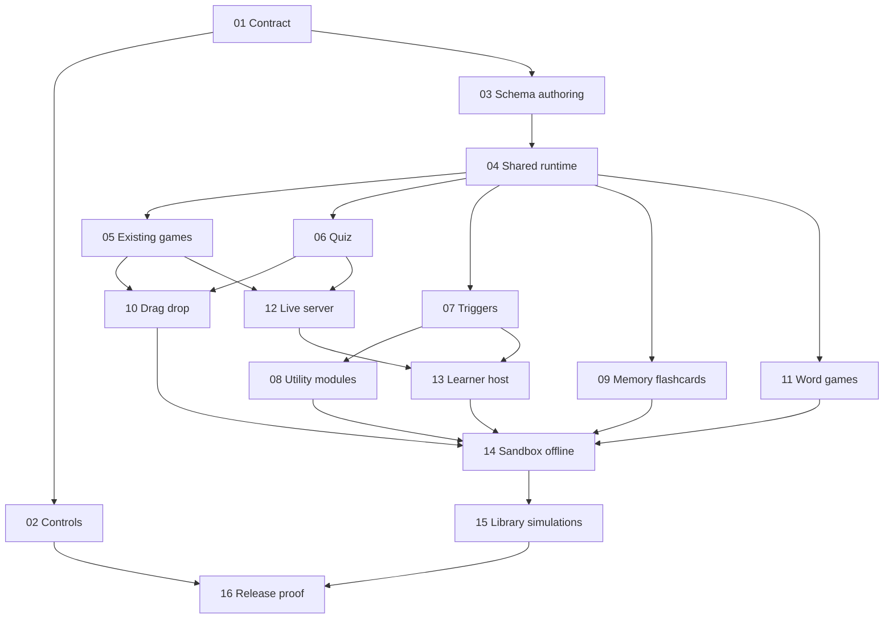

# Interactive HTML Education — Deep TDD

## Outcome và phạm vi

Người dùng soạn khối bằng controls → lưu/mở lại → Try/Present → Share → tải một HTML portable → mở file với mạng bị chặn → trả lời, mô phỏng, tính điểm và Reset được. Live dùng server và hai thiết bị học viên; không hứa multiplayer trong file offline.

Giữ **toàn bộ** đề xuất review, gồm sửa controls, 10 game cũ, 7 dạng câu hỏi, triggers/biến điểm, wheel/timer/scoreboard, memory/flashcards, kéo-thả, crossword/word-search, thư viện khối và 6 mô phỏng sẵn có. Không triển khai production trong phiên lập plan.

- [Scope ledger](./reports/scope-ledger.md): từng đề xuất, phase xử lý, tiêu chí nghiệm thu.
- [Execution contracts](./reports/execution-contracts.md): kiến trúc, schema, ownership, chế độ local/live và đính chính review.
- [Research/evidence index](./reports/evidence-index.md): nguồn repo, nghiên cứu và giới hạn bằng chứng.

## Quyết định kiến trúc

- Giữ 19 element types; educational blocks là subtype của `game`. Từ 10 lên 19 game subtypes, gồm `quiz` và 8 modules khác; `matching` hiện có nhận local drag-drop.
- Shared pure rules + browser DOM presenters, bundle IIFE bằng esbuild đã cài. Generated Reveal HTML và Try dùng cùng runtime; không bundle toàn bộ React app hay duy trì hai bộ luật game.
- Local chạy không server; Live dùng authority/socket hiện có. Timer local theo deadline, live theo server; không đọc `window.parent.__timerStates` trong presenter mới.
- Script HTML vẫn chạy trong iframe `allow-scripts`, không quyền same-origin. Portable export gom dependency được khai báo; tài nguyên không đóng gói được phải báo lỗi cụ thể.
- Không đổi luật chấm điểm sản phẩm chỉ vì review suy đoán. Phase 01 xác minh; Phase 05/12 thống nhất nguồn state/score. Offline chứa đáp án nên không bảo mật answer keys; Live player nhận public projection không có đáp án.

## Trạng thái tạm dừng và nguồn implementation

Người dùng yêu cầu commit checkpoint, không chạy lại tests và tạm dừng cook. Implementation hiện nằm trong worktree `C:/Work/worktrees/NavSlidesEditor-education-gemini38-cook-261001`, nhánh `feat/education-gemini38-cook-261001`, chưa được nhập vào `main`. [Handoff và TODO tiếp tục](../handoffs/education-pause-20261004.md) giữ bằng chứng và next actions. Phase01–03 đã có qualified historical checkpoints; chúng không chứng minh source hiện tại. Phase04 standalone checkpoint trước đây không đóng current-subject acceptance; Phase04–16 vẫn chưa hoàn tất qualification.

## Roadmap — historical checkpoints và qualification còn mở

- [x] [01 — Baseline, đính chính và khóa contract](./phase-01-start.md) — dependency: none; historical checkpoint.
- [x] [02 — Controls, alignment, fanout và 19-element audit](./phase-02-editor-controls.md) — 01; historical checkpoint.
- [x] [03 — Schema, registry và soạn đủ game](./phase-03-schemas-authoring.md) — 01; historical checkpoint.
- [ ] [04 — Runtime standalone và generated-document integration](./phase-04-standalone-runtime.md) — 03; current-subject acceptance còn mở.
- [ ] [05 — Chạy đủ 10 game cũ, timer/score/reset](./phase-05-existing-games.md) — 03, 04.
- [ ] [06 — Native quiz, 7 question kinds](./phase-06-native-quiz.md) — 03, 04.
- [ ] [07 — Triggers, visibility và biến điểm](./phase-07-triggers-variables.md) — 04.
- [ ] [08 — Lucky wheel, countdown và scoreboard](./phase-08-utility-modules.md) — 03, 04, 07.
- [ ] [09 — Memory và flashcards](./phase-09-memory-flashcards.md) — 03, 04.
- [ ] [10 — Matching/sorting/ordering với drag, touch và keyboard](./phase-10-drag-drop.md) — 03, 04, 05, 06.
- [ ] [11 — Crossword và word-search](./phase-11-word-games.md) — 03, 04.
- [ ] [12 — Live server authority và typed answers](./phase-12-live-server.md) — 03, 05, 06.
- [ ] [13 — Learner UI và host UX đồng bộ, reuse bridge12](./phase-13-live-player.md) — 04, 07, 12.
- [ ] [14 — Sandbox và portable offline closure](./phase-14-sandbox-offline.md) — 04–11, 13.
- [ ] [15 — Library, native quiz templates và simulation presets](./phase-15-templates-simulations.md) — 05, 06, 08–11, 14.
- [ ] [16 — Full behavior matrix, docs và release evidence](./phase-16-release-gates.md) — 01–15.



## Execution và TDD

`--deep --tdd`, không phải `--parallel` execution mode. Các phase documents được soạn song song; implementation theo dependency, integration owner duy nhất ở shared chokepoints. Re-scout trước từng phase; phase đã có chi tiết nhưng code có thể thay đổi.

Mỗi phase: Tests Before (RED đúng nguyên nhân) → implementation → GREEN → refactor → actual browser smoke → docs/changelog. Test chứng minh hành vi, lỗi và invariant; không test copy/source text/wiring. Chỉ đánh dấu hoàn thành khi có bằng chứng. Production modules mới/tách <200 LOC.

## Planning gates

- Research: 6 source slices và 2 primary-source research slices; nguồn [index](./reports/evidence-index.md).
- Red-team: completed; 4 personas, 16 findings thành14 nhóm đã sửa execution instructions. [Disposition](./reports/red-team-disposition.md) giữ links tới original reports và future acceptance; không phải production fixes đã PASS.
- Validation: CLI format smoke và whole-plan static checks completed. [Evidence/limits](./reports/validation.md); không có RED/GREEN/browser/package PASS cho implementation.
- Hydration: phase checklist là authority; runtime tasks chỉ là projection, dependencies giữ trong phase frontmatter.

## Red Team Review

Public audience serialization, effective inherited-instance identity, canonical live/preview readers, +10 Trivia buzz policy, variable admission/local utility authority, native editable media, shipped plugin peer và package-before-gate ordering đã có owner/cutover/behavioral acceptance. Chi tiết trong [disposition](./reports/red-team-disposition.md).

### Whole-Plan Consistency Sweep
- Đã đọc lại root và16 phase documents; shared chokepoints có integration owner, không có duplicate CREATE owner.
-16 phases /56 dependency edges không cycle; canonical matrix19 khớp actual defaults, game matrix19, scope ledger26 outcomes còn nguyên.
- Stale prerequisite-bundle/evaluator ownership instructions đã reconciled; unresolved planning contradictions trong checked scope:0.

## Validation Log

- Tier Full: evidence-backed Fact Checker, Flow Tracer, Scope Auditor và Contract Verifier reports được adjudicate; số liệu source probes được giữ riêng, không cộng thành implementation coverage.
- Questions asked:0; không có product decision mới cần interview. Kiến trúc và full scope giữ nguyên, source policy/consumer cutovers được phục hồi.
- `ak plan validate plans/261001-0639-interactive-html-education-deep-tdd --json --no-interactive`: exit0, valid=true, errors=null.
- Static smoke:179 known-existing inventory rows /107 paths,0 missing;95 unique focused test targets đều tồn tại hoặc được declare proposed. Current-source browser lanes và vendor publication có trong executable commands.
- Whole-plan sweep: decisions đã propagated sang root/contracts/phases; local links, dependency targets và matrix membership được kiểm tra. [Validation report](./reports/validation.md) ghi rõ proof boundaries.
- Ready to start Phase01 khi người dùng chọn implementation; tất cả16 production phases vẫn pending. Runtime/browser/file/live/Windows proof chưa chạy.


## Handoff

Bắt đầu Phase 01, chưa bắt đầu implementation tự động. Sau khi planning gates được chốt:

```text
/ak:cook C:/Work/NavSlidesEditor/plans/261001-0639-interactive-html-education-deep-tdd/plan.md
```

Không tự thêm `--auto`, commit, push hoặc deploy.

<!-- slug: interactive-html-education-deep-tdd -->
