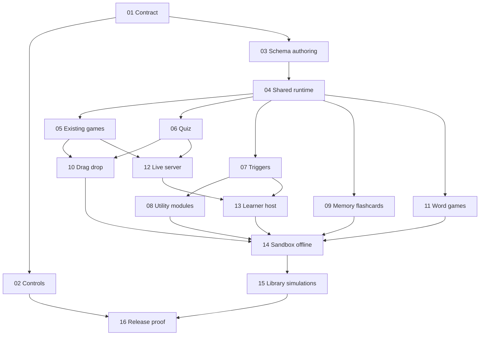

# Interactive HTML Education — Deep TDD

## Outcome và phạm vi

Người dùng soạn khối bằng controls → lưu/mở lại → Try/Present → Share → tải một HTML portable → mở file với mạng bị chặn → trả lời, mô phỏng, tính điểm và Reset được. Live dùng server và hai thiết bị học viên; không hứa multiplayer trong file offline.

Giữ **toàn bộ** đề xuất review, gồm sửa controls, 10 game cũ, 7 dạng câu hỏi, triggers/biến điểm, wheel/timer/scoreboard, memory/flashcards, kéo-thả, crossword/word-search, thư viện khối và 6 mô phỏng sẵn có. Không triển khai production trong phiên lập plan.

- [Scope ledger](./reports/scope-ledger.md): từng đề xuất, phase xử lý, tiêu chí nghiệm thu.
- [Execution contracts](./reports/execution-contracts.md): kiến trúc, schema, ownership, chế độ local/live và đính chính review.
- [Research/evidence index](./reports/evidence-index.md): nguồn repo, nghiên cứu và giới hạn bằng chứng.

## Quyết định kiến trúc

- Giữ 19 element types; educational blocks là subtype của `game`. Từ 10 lên 19 game subtypes, gồm `quiz` và 8 modules khác; `matching` hiện có nhận local drag-drop.
- Shared pure rules + browser DOM presenters, bundle IIFE bằng esbuild đã cài. Generated Reveal HTML và Try dùng cùng runtime; không bundle toàn bộ React app hay duy trì hai bộ luật game.
- Local chạy không server; Live dùng authority/socket hiện có. Timer local theo deadline, live theo server; không đọc `window.parent.__timerStates` trong presenter mới.
- Script HTML vẫn chạy trong iframe `allow-scripts`, không quyền same-origin. Portable export gom dependency được khai báo; tài nguyên không đóng gói được phải báo lỗi cụ thể.
- Không đổi luật chấm điểm sản phẩm chỉ vì review suy đoán. Phase 01 xác minh; Phase 05/12 thống nhất nguồn state/score. Offline chứa đáp án nên không bảo mật answer keys; Live player nhận public projection không có đáp án.

## Tạm dừng theo yêu cầu người dùng

Cook đang **tạm dừng**, không hoàn thành và không được phát hành. Người dùng yêu cầu commit checkpoint, không chạy lại tests, dọn scratch/worktree thừa và bàn giao việc còn mở. [Handoff và TODO tiếp tục](../handoffs/education-pause-20261004.md) là điểm vào để resume. Phase01–03 chỉ là qualified historical checkpoints; Phase04–16 và full current-subject qualification vẫn mở.

- [x] Dừng ba producer acceptance `author`, `timed`, `references`; chưa có file mới khác snapshot khi dừng.
- [ ] Exercise bảy quiz kinds: authored content/answers/media/reorder, save/reload/undo/duplicate và grading theo stable IDs.
- [ ] Exercise memory/flashcards content/reorder/history theo stable pair/card IDs.
- [ ] Exercise trigger Share/file parity và UI variable/fragment/reference remapping histories.
- [ ] Exercise quiz/legacy pending deadlines: leave/return/reset trên generated Present, Share và downloaded file.
- [ ] Exercise native pointer capture/interrupted drag; cancellation không assignment hoặc đổi score.
- [ ] Exercise contradictory/bounded puzzle authoring errors, sửa bằng controls và replay thật.
- [ ] Exercise Hot Potato bonus, Scatter unique duplicates và Trivia buzz policy branches phân biệt được.
- [ ] Exercise Bode invalid-input recovery và three-phase amplitude/speed/pause/resume controls.
- [ ] Exercise nested native-project media sau khi original sources không còn truy cập được.
- [ ] Review độc lập và chạy focused verification cho các acceptance bổ sung; không coi producer drafts hoặc test count là PASS.
- [ ] Fresh complete source/config/docs freeze trên D:, production-mode isolated build và sequential exact-subject browser/static/live/Electron-development/new Windows-package lanes.
- [ ] Hoàn tất broad affected E2E và `education-release-gate.mjs`; chỉ tick Phase04–16 khi đủ receipts đúng subject/scenario. Không dùng lại failed/historical release receipts.

## Execution progress

Implementation đã có cho toàn bộ phạm vi trong worktree được ủy quyền; chưa có full-scope acceptance hoặc release qualification. Phase01–03 có qualified checkpoint trước đây, không phải proof cho source đã đổi sau checkpoint. [Baseline superseding assessment](./reports/baseline-evidence.md) giữ giới hạn của historical runs; [qualified Phase01–03 checkpoint](file:///C:/Work/NavSlidesEditor/plans/reports/orchestrate-261001-education-gemini38/phase-03-completion-qualification-counsel.md) là report có thật trong coordinator checkout, không phải worktree-local receipt.

Phase04–11 đã bàn giao implementation slices nhưng final per-surface qualification còn mở. [Name-picker qualification counsel](file:///C:/Work/NavSlidesEditor/plans/reports/orchestrate-261001-education-gemini38/phase04-final-qualification-counsel.md) chỉ giữ proof của checkpoint standalone trước đây; không thay all-game/current-subject receipts. Integration owner đã exercise Jeopardy/Scoreboard DOM region repair bằng current-source isolated compiled runtime trên real generated Present: Scoreboard pointer tăng/giảm0→1→0 và Jeopardy cell/question/reveal/award/reset hoạt động, nested inert regions absent. Scoreboard Reset vẫn pending full-surface journey. `.tmp/region-input-smoke.png` giữ visual observation; đây không phải published runtime hoặc full frozen-subject qualification.

Phase12–16 đã có implementation; live host + hai learner, sandbox/portable toàn phạm vi, presets/static outputs, Electron development và newly built Windows package vẫn cần receipts đúng scenario và subject. Native-media archive/import và imported portable file có bounded actual smoke; plugin-boundary journeys và focused evidence-integrity checks được giữ riêng, không suy thành release cells. Integration owner đã quan sát targeted delayed replay với actual server packets, draft/focus/generation/current-answer checks; proof này không đóng full live matrix. Các run `--reporter=line` hiện có chỉ là preliminary.

Current-subject preliminary integration: 44 actual Chromium game/native-preset journeys passed across Try/Present/Share/downloaded network-blocked files; all seven live education suites passed (30 tests, authenticated host plus two independent learners). Native publication, PID-fixture provenance, raster/storage/qualification-stage integration passed 20 files / 74 tests. The full unit integration run passed 795 files and 6,192 tests, with 3 skipped. Current dependency provenance is independently recorded in [dependency-change-evidence.json](./reports/dependency-change-evidence.json); its subject remains unqualified/non-publishable and historical release ledgers are unchanged. Field/lifecycle/browser/static and desktop qualification still require their own successful runs and exact-subject receipts; these preliminary totals do not close phase checklists.

Latest bounded preliminary closure: canonical icon JSON is included without admitting mutable/secret data; six focused suites passed (56 tests), and a real locked isolated install/production build completed from 2,456 declared inputs. The staged shared renderer and Chromium displayed authored icon geometry/paint. All six unchanged baseline browser journeys passed without retries, with two scoped independent review GOs. An actual normal UI portable download completed word-search using native pointer drag and endpoint clicks, then Reset, with zero HTTP(S), sockets or page errors. This resolves the duplicate static/runtime observer ambiguity without a product change. No final frozen-subject or Windows-package receipt is implied.

Latest whole-unit rerun passed 795 files / 6,196 tests, with 3 existing skips; lint exited 0 with 0 errors / 222 warnings and documentation build passed. Advisory supervision returned GO for a fresh complete-input freeze, isolated unsigned Windows build and separate exact-artifact lanes—not release approval.

Fresh Windows beforePack subsequently exposed source leaves still pruned by generated-metadata prefixes (`inventory.js` and runtime-receipt/release-state sources). Classification now admits recognized executable source after the unchanged privacy guards, without special-casing callers. The real native staging regression was RED before / GREEN after; six focused suites passed (57 tests). An actual 2,465-input source-only stage had matching source/stage hashes and ran native reconciliation while metadata/private data remained excluded. Failed complete-input context/stage are retained; no final browser receipts had started. The next isolated build must use production mode, not the failed launcher's development-mode bundle, and needs a fresh freeze and actual lane qualification.

Post-repair whole-unit receipts now pass all 795 inventoried files and 6,197 tests, with 3 unchanged skips; lint remains 0 errors / 222 warnings and docs build passed. Scoped counsel confirmed bounded repair GO only. Fresh production-mode isolated packaging and all exact-subject release lanes remain pending; no old context, stage or release receipt is reused.

Production-mode Windows build của subject trước đã tạo installer thật; actual native Node Electron-dev run passed 25 gameplay/reset/CSP scenarios. Installer attestation vẫn từ chối đúng: standalone 7za không đọc NSIS, rồi source-stage `image-size` junction không self-contained. Đã sửa đúng owner/tool boundary, giữ failed stage/context/installer. Real NSIS regression RED-before/GREEN-after; 11 integrated suites passed 86 tests, gồm actual local-only npm ci → builder extraResources → genuine NSIS byte identity. Actual production dependency owner smoke cài 212 packages, publish exact ordinary vendor bytes, xóa vendor source rồi quan sát server resolve bản đóng gói với parser vẫn disabled. Scoped counsel GO cho new freeze/stage và complete fresh qualification; không tái gắn 25 old-subject Electron results hoặc old artifacts vào source đã đổi. Whole-unit/lint/docs rerun và independent scoped reviews đang chạy.

Current native-fixture closure: final uninstrumented `test:feature-inventory` exited 0 with the exact 799-file inventory, 6,232 passed tests, zero failures and 3 unchanged skips (`.tmp/education-full-unit-20261004-clean-final.json`). All 30 repaired CLI/converter cases and the 55 history/presentation owner cases passed. Failed full receipts and the separate instrumented replay remain retained; no original history/presentation timeout cause or production repair is claimed. Original owner source is restored, with no timeout/retry/cap/production-policy changes. Lint exited 0 with 0 errors / 222 warnings and docs build passed. Scoped counsel returned GO for clean documentation recording, a fresh source/config/docs freeze and a distinct production-mode Windows stage only. Every artifact lane requires new receipts; no acceptance checkbox is closed by the unit replay.

The subsequent frozen browser lane passed 426 scenarios and failed two: authored Markdown print highlighting and word-search PPTX OCR content. An actual ordinary launch of the new packaged executable exposed `MODULE_NOT_FOUND` for a repository-relative shared quiz import. Native NSIS test routing is repaired with 24 focused tests passing; canonical installed-package server imports and constrained code-language sanitization have 77 focused tests plus separate real authority/print smoke. Failed browser/native artifacts are retained. These changed inputs invalidate the previous subject; new freeze/build and all required actual lanes remain open. No release or rebuilt Windows-runtime GO is implied.

The cause-aligned repairs now pass the original three normal UI export cases without retries: Markdown print and word-search PDF/PPTX default/teacher. The PPTX layout and strict `CAT`/title/paint/reveal assertions are unchanged; only generic raster OCR segmentation changed. Real actual referenced raster and print screenshots were inspected. Current production client build/runtime closure passed; lint remains 0 errors / 222 warnings and docs build passed before the last evidence entry. Full exact unit verification is running, followed by a fresh complete-input freeze and independently exercised artifact lanes. These are preliminary working-tree results, not final subject acceptance.

Post-repair exact full producer is GREEN: 799 files, 6,237 passed tests, zero failed and 3 unchanged skips (`.tmp/education-full-unit-20261004-package-language-ocr.json`). Final repair lint/docs completed successfully (0 errors / 222 warnings). Scoped counsel permits the next fresh freeze and clean build; the full browser/E2E/native/package matrix remains unqualified until independently executed against that subject. Broad E2E runs use a distinct run/output without the education reporter context so unrelated runner outcomes cannot contaminate the required-cell receipt.

Fresh subject `dcb163d43020d637e394b8c10d640c580a9e2ff255c6a1811532c306c82487ab` copied 2,470 inputs into `C:/Work/edu-qual-261004-package-language-ocr`; locked Windows build, vendor/runtime closure, actual development and new unpacked Home launches, and installer/embedded-source identity admission passed. Both emitted binaries are `NotSigned`. Two independent-context repair reviews found no blocking defect; no model-family independence is claimed. Actual desktop qualification then passed 44 cases and failed 6: five installer extraction cases explicitly reported insufficient disk space; word-search launch timed out with cause unproven. The failed context/receipts/artifacts remain intact. C: has roughly 2.2 GB free while D: has roughly 293 GB; counsel approves new execution scratch/output on D: and fresh run metadata using unchanged source/binaries, without deleting earlier stages, changing checks or promoting old PASS records. Browser execution is still in flight; final acceptance remains open.

Recovered D: scratch browser qualification completed without retries: 426 passed / 2 failed (`artifact://2626`, distinct r2 context/evidence). The LaTeX trace proves actual controls and canvas reached 480×320, PUT returned 200 with those values and the queued GET eventually matched; the unchanged five-second poll expired during a 4.585-second post-mutation atomic-save wait. Its underlying filesystem/runtime cause remains unproved; no geometry, storage, debounce or assertion-window repair is claimed. Hot Potato's preserved UI reached timer zero without expiry feedback. An exact-module fractional-clock diagnostic reproduced a one-shot callback 0.5 ms early, correctly rejected by the strict reducer but never rearmed. The scheduler now rearms through the existing session until the unchanged deadline; the regression was RED before / GREEN after and seven affected suites passed 57 tests. Actual rebuilt Chromium author/save/reload/Try observed expiry within eight seconds and a late correct answer scoring 10 base + 0 speed bonus. The historical callback timestamp was not captured, so its exact trigger remains inferred. Changed production inputs invalidate r2 for final acceptance; new full-unit/lint/docs proof, freeze/build and all required lanes remain mandatory. All failed receipts stay retained and no acceptance checkbox is promoted.

The deadline-rearm exact full producer passed 800 files / 6,242 tests, with zero failures and 3 unchanged skips (`.tmp/education-full-unit-20261004-deadline-rearm.json`). Lint exited 0 with 0 errors / 224 warnings; docs build passed. Advisory supervision approves a new immutable freeze and isolated `D:/NavSlidesQualification/education-final-20261004-deadline-rearm-stage/stage`, with D: scratch/output and sequential independently identified qualification lanes. No prior PASS, failed receipt or acceptance checkbox is promoted; all fresh exact-subject browser/native/package and broad E2E evidence remains required.

Current countdown/native-input closure has RED-before/GREEN-after mounted lifecycle proof (16 tests) and a nine-case real Chromium rerun passing Present/Share/network-blocked downloaded-file utility, card and Vietnamese puzzle journeys without retries or deadline changes. Native CDP composition start/update/composing input are trusted; composition end target/data and NFC results are checked without claiming native OS IME or real mobile hardware. Exact failed traces independently identified the hidden static/runtime word-list observer ambiguity; the repair requires a unique visible authored runtime word with strike-through. These preliminary results do not qualify a frozen subject. Independent local acceptance review still requires content/reorder history, trigger surface/reference transitions, pending-round deadlines, interrupted drag, puzzle authoring recovery and distinguishing legacy scoring branches; live/qualification review additionally identifies simulation-control and nested-media boundaries. Preserve earlier contexts/receipts and complete these producers before the next freeze.

Phase checklists vẫn là acceptance authority; chưa tick thêm acceptance chưa có receipt. Integration owner giữ exact-subject source/config/docs freeze sau preliminary smoke và subsequent qualification qua `scripts/feature-inventory/education-release-gate.mjs`; test totals, source pins và historical greens không đóng gate. Phần context, proposed inventory và Tests Before bên dưới các phase là planning/baseline material, không phải assertion rằng implementation hiện chưa tồn tại.

## Roadmap — qualified checkpoint và ongoing qualification

- [x] [01 — Baseline, đính chính và khóa contract](./phase-01-start.md) — dependency: none; qualified checkpoint.
- [x] [02 — Controls, alignment, fanout và 19-element audit](./phase-02-editor-controls.md) — 01; qualified checkpoint.
- [x] [03 — Schema, registry và soạn đủ game](./phase-03-schemas-authoring.md) — 01; qualified checkpoint.
- [ ] [04 — Runtime standalone và generated-document integration](./phase-04-standalone-runtime.md) — 03.
- [ ] [05 — Chạy đủ 10 game cũ, timer/score/reset](./phase-05-existing-games.md) — 03, 04.
- [ ] [06 — Native quiz, 7 question kinds](./phase-06-native-quiz.md) — 03, 04.
- [ ] [07 — Triggers, visibility và biến điểm](./phase-07-triggers-variables.md) — 04.
- [ ] [08 — Lucky wheel, countdown và scoreboard](./phase-08-utility-modules.md) — 03, 04, 07.
- [ ] [09 — Memory và flashcards](./phase-09-memory-flashcards.md) — 03, 04.
- [ ] [10 — Matching/sorting/ordering với drag, touch và keyboard](./phase-10-drag-drop.md) — 03, 04, 05, 06.
- [ ] [11 — Crossword và word-search](./phase-11-word-games.md) — 03, 04.
- [ ] [12 — Live server authority và typed answers](./phase-12-live-server.md) — 03, 05, 06.
- [ ] [13 — Learner UI và host UX đồng bộ, reuse bridge12](./phase-13-live-player.md) — 04, 07, 12.
- [ ] [14 — Sandbox và portable offline closure](./phase-14-sandbox-offline.md) — 04–11, 13.
- [ ] [15 — Library, native quiz templates và simulation presets](./phase-15-templates-simulations.md) — 05, 06, 08–11, 14.
- [ ] [16 — Full behavior matrix, docs và release evidence](./phase-16-release-gates.md) — 01–15.

## Execution và TDD

`--deep --tdd`, không phải `--parallel` execution mode. Các phase documents được soạn song song; implementation theo dependency, integration owner duy nhất ở shared chokepoints. Re-scout trước từng phase; phase đã có chi tiết nhưng code có thể thay đổi.

Mỗi phase: Tests Before (RED đúng nguyên nhân) → implementation → GREEN → refactor → actual browser smoke → docs/changelog. Test chứng minh hành vi, lỗi và invariant; không test copy/source text/wiring. Chỉ đánh dấu hoàn thành khi có bằng chứng. Production modules mới/tách <200 LOC.

## Planning gates

- Research: 6 source slices và 2 primary-source research slices; nguồn [index](./reports/evidence-index.md).
- Red-team: completed; 4 personas, 16 findings thành14 nhóm đã sửa execution instructions. [Disposition](./reports/red-team-disposition.md) giữ links tới original reports và future acceptance; không phải production fixes đã PASS.
- Planning validation: CLI format smoke và whole-plan static checks completed tại planning checkpoint. [Evidence/limits](./reports/validation.md) chỉ chứng minh plan, không thay implementation receipts ở Execution progress.
- Hydration: phase checklist là authority; runtime tasks chỉ là projection, dependencies giữ trong phase frontmatter.

## Red Team Review

Public audience serialization, effective inherited-instance identity, canonical live/preview readers, +10 Trivia buzz policy, variable admission/local utility authority, native editable media, shipped plugin peer và package-before-gate ordering đã có owner/cutover/behavioral acceptance. Chi tiết trong [disposition](./reports/red-team-disposition.md).

### Whole-Plan Consistency Sweep

- Đã đọc lại root và16 phase documents; shared chokepoints có integration owner, không có duplicate CREATE owner.
  -16 phases /56 dependency edges không cycle; canonical matrix19 khớp actual defaults, game matrix19, scope ledger26 outcomes còn nguyên.
- Stale prerequisite-bundle/evaluator ownership instructions đã reconciled; unresolved planning contradictions trong checked scope:0.

## Validation Log

- Tier Full: evidence-backed Fact Checker, Flow Tracer, Scope Auditor và Contract Verifier reports được adjudicate; số liệu source probes được giữ riêng, không cộng thành implementation coverage.
- Questions asked:0; không có product decision mới cần interview. Kiến trúc và full scope giữ nguyên, source policy/consumer cutovers được phục hồi.
- `ak plan validate plans/261001-0639-interactive-html-education-deep-tdd --json --no-interactive`: exit0, valid=true, errors=null.
- Static smoke:179 known-existing inventory rows /107 paths,0 missing;95 unique focused test targets đều tồn tại hoặc được declare proposed. Current-source browser lanes và vendor publication có trong executable commands.
- Whole-plan sweep: decisions đã propagated sang root/contracts/phases; local links, dependency targets và matrix membership được kiểm tra. [Validation report](./reports/validation.md) ghi rõ proof boundaries.
- Implementation đang tiếp tục trên accepted full scope; qualified checkpoint01–03 và các pending runtime/browser/file/live/Windows receipts được phân biệt ở Execution progress, không còn trạng thái all-pending.

## Handoff

Tiếp tục authorized `cook --auto --advice --tdd` trên accepted plan và dependency graph; không bắt đầu lại baseline hoặc thu hẹp scope. Integration owner giữ runtime verification và exact-subject qualification; phase chưa đủ acceptance evidence vẫn `in_progress`.

Không commit, push hoặc deploy trong phiên này.

<!-- slug: interactive-html-education-deep-tdd -->
