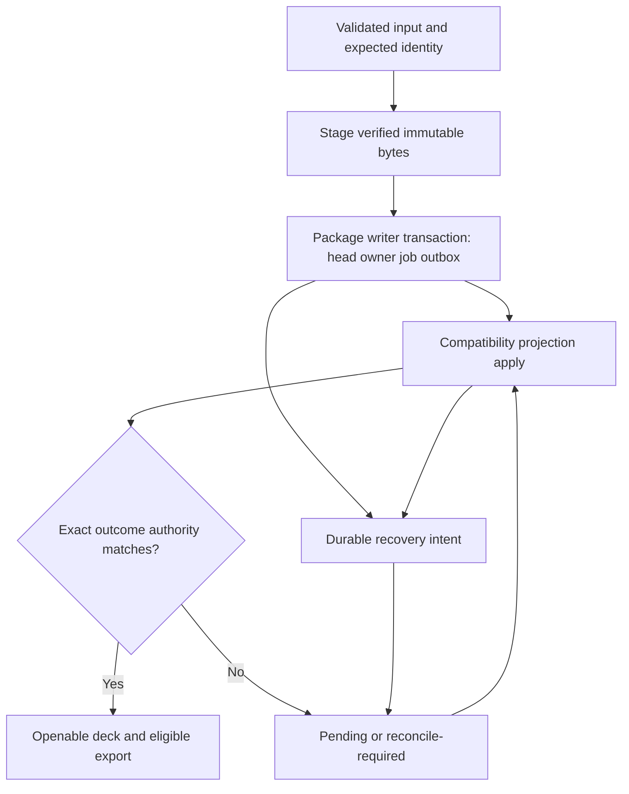

# Decisions, boundaries và execution architecture

## Scope contract

HOLD SCOPE: thực hiện toàn bộ chặng 0–5 trong attachment, không chỉ Settings. 16 phase tách theo invariants và gate để review/test độc lập, không phải 16 service mới. Không --html, --github, --wiki; deliverable là Markdown và task projection. Không thực thi product code trong phiên lập kế hoạch.

## Quyết định thiết kế của kế hoạch

Đây là quyết định đề xuất bởi người lập kế hoạch, **không ghi là user đã duyệt trước đó**. Conservative defaults tránh cần hỏi những dữ kiện có thể đọc từ repo.

| Quyết định | Chọn | Vì sao / đổi lại |
|---|---|---|
| Settings lost update | Atomic storage helper + persisted revision, If-Match | Chặn cả race server và stale full form; breaking API phải deploy UI cùng server |
| Settings response | Baseline/submitted/draft + apiKey intent | Không mất edits đang chờ; thêm state nhưng không global framework |
| CI | Required IDs success-only | Missing/skipped không được pass; optional jobs policy riêng |
| Scanner | Adapter/schema pinned + target coverage + identity binding | Clean absent Vulnerabilities hợp lệ; empty/malformed không chứng minh clean |
| History | Verify existing fix trước, sửa chỉ khi RED | Không làm lại redo đã sửa hoặc trộn undo của TipTap với document |
| PPTX | Giữ package-store/WAL/outbox và owner model | Không transaction engine thứ hai; closure từng invariant |
| Recovery | Durable intent/reconcile; audit-only orphan blobs | Cleanup session-owned có proof; không destructive GC chưa có retention policy |
| Portable import | Create-new mặc định; explicit replace với expectedHead | Không silently clobber destination; thêm versioned archive integration |
| Performance | Measure → memo/lazy → windowing nếu cần | Bảo toàn DnD/focus/children trước giảm DOM |
| Release | Giữ Linux/container + Windows NSIS/portable gates | Không scope-cut để né Office/signing prerequisites |
| Trust boundary | Giữ mô hình private single-operator/trusted author của hiện trạng | Không biến thành platform auth/untrusted-content isolation ngoài yêu cầu; không chứng nhận public exposure an toàn |
| Documentation | Facts catalog nhỏ + EN/VI sync | Không generate toàn bộ prose hoặc test exact wording |

## Cross-store publication architecture

Commit authority, projection visibility, media placement và receipt là các ranh giới khác nhau. Original immutable vẫn được bảo toàn nếu edited export hoặc projection thất bại. Atomic rename một file không làm các bước trên thành transaction nhiều file.

## Shared ownership và migration callers

- Integration owner giữ `package.json`, test inventory/config, workflow gate wiring, docs/changelog. Không hai lanes sửa cùng file đồng thời.
- Settings lane phases 02→03; HTTP consumer `client/src/pages/SettingsPage.jsx`; tests `server/routes/settings-merge.test.js`, `server/routes/api-surface.test.js`; fixture writers `server/routes/ai.test.js`, `server/services/storage.test.js`. Giữ read consumers của AI không cần precondition; phase-entry enumerate lại trước thay shape persisted settings.
- PPTX lane phases 07→08→09→10 dùng chung package store/lifecycle/outbox, tuyệt đối tuần tự. Save/export/history/template readers cần authority migration tại existing owner, không shim song song.
- Portable methods: `server/services/pptx-import/package-store/index.js:187–191` forwards export/import; production export consumer thấy ở `server/routes/sync.js:195`; tests `portable.test.js` và `sync.test.js`. `importPresentationPackage` hiện được gọi qua store/tests, chưa là full project import.
- Phase 10 chốt full package-backed ZIP manifest v2.0 qua server GET `/api/presentations/:id/project-archive`; Editor export dùng save/export barrier. Home và Editor Open Project cùng `importProjectAtomically`; migrate `use-export-actions.js`, export/import utils, API và server archive validation/limits. Legacy projection-only JSON và agent `scripts/agent/file-export-tools.mjs` format=json vẫn reference-only, không claim full backup. Sync giữ folder package/_uploads riêng. Destination media map áp dụng cả compatibility và canonical pending/committed projection; preserve Original bytes.
- CI/security lane phases 04 và 05 độc lập sau baseline, converge phase 11. Phase 16 owns lock-refresh GitHub workflow, không Electron app permission.
- Editor lane 06→13→14; không đồng thời sửa EditorPage/controller shared state với PPTX client migration.
- Phase 15 tích hợp factual docs sau lanes. Phase 16 final freeze/qualification, không phụ thuộc ngược từ earlier phase về final.
- Windows phase 12 sửa physical adapter, separate producer run IDs, independent Authenticode/RFC3161 và genuine attestation normalization; phase 16 tích hợp, không tạo normalization owner song song. Windows packaging dùng verified downloaded client, không rebuild qua electron:build:win.
- Linux receipt phase 16 bắt buộc actual leaf/job/shard evidence, không hash lời khai passed. Readiness/recovery phase 09 phải chạy qua startup production trước admission, không chỉ helper harness.

## Load-bearing assumptions và stop signals

| Assumption | Signal hỏng | Hành động |
|---|---|---|
| Settings chạy single writer process | Deployment có nhiều API process cùng data dir | Stop deploy; không claim mutex đủ; chọn shared lock/storage transaction bằng plan revision |
| Package root/readers có unique authority | Ambiguous owner/head/journal khi recover | Fail closed, preserve/quarantine, không regenerate defaults |
| Scanner pin/output đầy đủ | New schema, partial scan, target không có coverage | Không receipt passed; cập nhật adapter/fixture evidence |
| Real Office/signing có thể provision | Thiếu runner/license/protected signer | Block target; không substitute mocked receipt/self-signed artifact |
| Performance measurement ổn định | Variance vượt baseline tolerance | Fix measurement environment, không điều chỉnh threshold sau kết quả |
| Public publication cần authorization | Chưa có approval publish/settings | Chỉ qualified-not-published hoặc blocked; không thực thi external writes |

## Phần không thêm vào yêu cầu

Không microservices/database rewrite; không TypeScript migration; không rewrite toàn editor; không mặc định virtualization; không permission/auth platform mới; không destructive GC; không hạ policy; không nâng dependencies hàng loạt. Phát hiện mới ngoài các invariants mục tiêu ghi risk, chỉ mở scope sau user decision.
